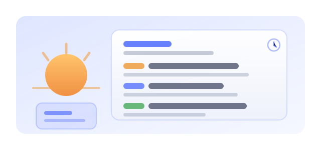

# dsh-news-digest · News digest

A [DeepSeek Harness](https://github.com/deepseek-ai/deepseek-harness) (`dsh`) plugin that
searches the live news once a day for the categories you pick and saves a **digest you can reopen**.

Two entry points: a **daily schedule** at the time you set, and **your first DSH use each morning**.
The second one watches two signals — DSH start, and the first human message of the day — and takes
whichever comes first, at most once per day.

<p align="center">
  
</p>

## What it does

- **Search** — a DSH schedule task starts one model turn per day; the model runs `web_search` once per
  category (category name + today's date + your keywords) and keeps the last 24–48 hours.
  The plugin never scrapes pages itself, so every link is a real search result.
- **Group** — the fixed categories (Domestic, World, Business, Tech, Sports, Entertainment, Society,
  Health) can be toggled; "Other" is where you add your own (AI, crypto, local news…). Each category
  takes optional keywords.
- **Report** — one-line overview, 1–5 highlights, then items grouped by category (title, one-sentence
  summary, source, link, time). Saved as json + md and readable/deletable under Settings.
- **No duplicates** — the scheduled run first checks whether today's digest already exists and stops
  if it does; running it again by hand the same day overwrites it.
- **Notification** — when a new digest is saved, a card appears in the corner of DSH (plus a system
  notification when allowed). "Open" launches a self-contained local HTML page
  (`reports/<date>.html`, follows the system light/dark setting).

## Install

Settings → Plugins → Add plugin, or:

```sh
dsh plugin --profile desktop add "link:/path/to/dsh-news-digest"
npm pack && dsh plugin --profile desktop add ./skyrocks-dsh-news-digest-0.1.0.tgz
```

Host-side changes need a full DSH restart; `client.js` changes only need a page refresh.

## Use

- **Settings → News digest**: pick categories, optional keywords, schedule time, the first-use window,
  "run now" (it saves your edits first), and the history list.
- **In chat**: `news_status`, `news_report`, `news_reports`, `news_categories`, `news_focus` are available to the model.

### Want mostly AI and new-tech news?

Stack three settings and save:

| Where | Value |
| --- | --- |
| Categories → Tech | on, keywords: `AI LLM agents open-source models chips` |
| Categories → Other (custom) | add "AI frontier", keywords: `LLM agent multimodal arXiv funding` |
| Extra focus | `AI industry moves, new releases, papers` |

- To see **only** AI: turn off Domestic / World / Business, keep Tech and the custom one.
- Raise "max per category" to 10 if you want more.
- Each category gets one search (name + date + keywords). If the extra focus is the same topic as an
  enabled category it is folded into that search instead of running twice; it gets its own search only
  when it means something else. AI/tech also gets an English search for first-hand sources.

## How the first-use trigger decides

| Signal | Meaning | Implementation |
| --- | --- | --- |
| Plugin load | the DSH process started | check once, 3 s after `apply()` |
| First human message | the first thing you actually typed today | `agent/inbox/inserted` with `message.source.kind === 'user'` |

DSH itself uses `source.kind` to tell human input apart from schedule deliveries and injected context,
so scheduled tasks, subagents and `inject()` never look like "someone is using it".

Both signals share `lastTriggerDay` in `state.json`: once the day fired (or today's digest already
exists), the other signal skips. Firing calls the schedule task's `run()`, so Settings → Scheduled tasks
keeps exactly one "News digest" row instead of one per day.

## Data

`$DSH_HOME/news-digest/` (`~/.dsh/news-digest/` by default): `settings.json`, `state.json`,
`reports.json`, and `reports/<date>.json` / `.md`.

## Limits

- Searching is a real model turn: it spends tokens and needs network access.
- It does not scrape or log in to news sites; a category with nothing found is reported as such,
  never padded with old stories.
- One session ("News digest") receives every run, created on the first delivery.
- Turning the plugin off stops new runs; saved digests stay.

## License

MIT
