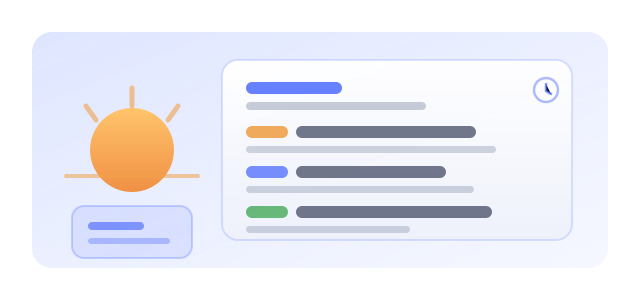

# dsh-news-digest · 新闻日报

给 [DeepSeek Harness](https://github.com/deepseek-ai/deepseek-harness)（`dsh`）用的插件：
每天按你勾选的类别搜一次实时新闻，汇总成一份**能回看的日报**。

两个出报入口：**每天定时**到点出一份；**每天上午第一次用 DSH** 时补一份。
后者看两个信号——DSH 启动、当天第一条真人消息——哪个先到算哪个，当天只触发一次。

<p align="center">
  
</p>

## 它做什么

- **搜**：到点由 DSH 的计划任务触发一次模型回合，模型用 `web_search` 按类别各搜一次
  （查询词 = 类别名 + 今天日期 + 你填的关键词），只看最近 24–48 小时。
  插件自己不抓网页，所以每条都是搜到的真实链接。
- **分**：固定类别（国内 / 国际 / 财经 / 科技 / 体育 / 娱乐 / 社会 / 健康）可以开关；
  「其他」是自定义类别，想加几个加几个（AI、加密货币、本地……）。每个类别都能填关键词。
- **报**：汇总成「一句话 + 最值得先看的 1–5 条 + 按类别分组的条目（标题 / 一句概括 / 来源 / 链接 / 时间）」，
  落盘 json + md，在设置页里回看、删除。
- **不重复**：定时那一条到点会先查「今天是不是已经有日报」，有就只回一句、不再搜。
  同一天在设置页里手动再出一次会覆盖上一份。

## 安装

设置 →「插件」→「添加插件」，粘贴仓库地址；或者命令行：

```sh
# 本地目录（开发时用）
dsh plugin --profile desktop add "link:/path/to/dsh-news-digest"

# 打包好的 tarball
npm pack
dsh plugin --profile desktop add ./skyrocks-dsh-news-digest-0.1.0.tgz
```

装完在「设置 → 新闻日报」里勾类别、定时间。Host 侧代码改完要**完全退出 DSH 再打开**；
只改 `client.js` 刷新页面即可。

## 用法

1. **设置 → 新闻日报**
   - 「类别」：勾上要搜的方向；关键词可选。下面「其他（自定义）」可以加自己的类别。
   - 「什么时候出报」：定时开关 + 时间；「每天第一次用 DSH 时补一次」开关 + 上午窗口 + 窗口外是否补。
   - 右上角「现在出一份」会**先保存当前改动**再跑一次（勾了没保存也算数），「保存设置」只写入。
   - 「历史日报」点开看全文，也能删。
2. **对话里**：模型可以用 `news_status` / `news_report` / `news_reports` / `news_categories` / `news_focus`。
   直接说「把体育也加上」「科技类多搜 AI 大模型」「以后新闻重点盯 AI」「今天有什么新闻」就行。

### 只想重点看 AI 和新技术？

三层设置叠起来用，改完点「保存设置」：

| 在哪 | 填什么 |
| --- | --- |
| 类别 → 科技 | 勾上，关键词：`AI 大模型 智能体 开源模型 多模态 芯片` |
| 类别 → 其他（自定义） | 加一个「AI 前沿」，关键词：`大模型 智能体 多模态 具身智能 AI 论文 arXiv 融资` |
| 额外关注 | `重点：AI 圈动态、新技术发布、模型与论文` |

- 想**只**看 AI：把「国内 / 国际 / 财经」关掉，只留「科技」和「AI 前沿」。
- 每类最多可以调到 10 条（默认 5）。
- 出报时每个类别各搜一次（类名 + 日期 + 关键词）；「额外关注」如果和某个已开启类别是同一主题，
  会并进那一次搜索而不是重复搜，另有所指时才单独再搜；AI / 科技类还会补一次英文搜索
  （`AI news today`、`LLM release` 这种），拿一手来源。
- 只想临时改一次、不动长期设置：对话里说「今天只搜 AI 的新闻」。

## 触发是怎么判断的

| 信号 | 含义 | 实现 |
| --- | --- | --- |
| 插件加载 | DSH 进程启动（=打开应用） | `apply()` 后延迟 3 秒检查一次 |
| 第一条真人消息 | 当天你真正敲进去的第一条 | `agent/inbox/inserted`，只认 `message.source.kind === 'user'` |

DSH 自己用 `source.kind` 区分「真人输入」和「计划任务投递 / 注入的上下文」，
所以定时任务、子代理、`inject()` 的内容都不会被误当成「人在用」。

两个信号共用 `state.json` 里的 `lastTriggerDay`：当天只要触发过一次（或今天已经有日报），
另一个信号就直接跳过。首次触发时调用计划任务的 `run()` 立即投递——所以「设置 → 定时任务」
里始终只有一条「新闻日报」，不会每天多一条。

## 数据

`$DSH_HOME/news-digest/`（默认 `~/.dsh/news-digest/`）：

```
settings.json        类别、时间、触发设置
state.json           今天触发过没有（去重依据）
reports.json         日报索引
reports/<日期>.json  结构化日报
reports/<日期>.md    可读版本
```

## 边界

- 搜索是一次真实的模型回合：会产生 token 消耗，跑的时候需要联网。
- 不自己抓网页、不翻墙、不登录任何新闻站；搜到什么写什么，没搜到的类别会说明，不拿旧闻凑数。
- 只有「新闻日报」这一个会话：第一次投递时创建，之后都投到同一个会话里。
- 关掉插件后不再触发；已经存下的日报不会被删。

## 开发

```sh
npm test     # store / report / trigger / tools / manifest，共 40+ 条断言
for f in *.js; do node --check "$f"; done
```

Host 侧（`index.js` / `service.js` / `store.js` / `report.js` / `schedule.js` / `trigger.js` / `tools.js` /
`typert.host.js`）改动后需要重启 DSH；`client.js` 改动后刷新页面。

## License

MIT
