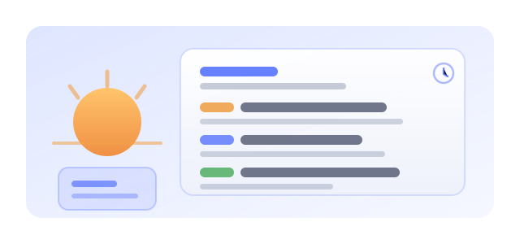

# 新闻日报

每天醒来第一件事不是刷七八个站，而是看一份已经汇总好的日报：按你勾的类别分组，
每条只留标题、一两句概括、来源和链接。

**两个触发入口**

- **定时**：每天在你设的时刻（默认 08:00）出一份。用的是 DSH 的计划任务，
  所以重开 DSH 后会补上错过的那一次。
- **每天上午第一次用 DSH**：DSH 启动，或者当天你敲进第一条消息——哪个先到算哪个。
  判定只看两件事：插件加载（=进程启动）和 `source.kind === 'user'` 的人发消息，
  所以计划任务投递、子代理、注入的上下文都不会被误当成「人在用」。当天只触发一次；
  如果今天已经有日报，两个入口都会跳过。

**类别**

固定类别（国内 / 国际 / 财经 / 科技 / 体育 / 娱乐 / 社会 / 健康）可以开关；
「其他」是自定义类别，想加几个加几个（比如 AI、加密货币、本地）。每个类别还能填关键词，
关键词会拼进搜索词。

**怎么搜**

插件本身不抓网页：到点由计划任务触发一次模型回合，模型用 `web_search` 按类别各搜一次，
再用 `news_report` 把结果存下来。所以每条链接都是搜到的真实地址，也不会编造新闻。

**数据**

存在 `$DSH_HOME/news-digest/`：`settings.json`（类别与触发设置）、`state.json`（当天是否触发过）、
`reports.json`（索引）、`reports/<日期>.json` 与 `.md`（正文）。设置页里能回看、能删。
